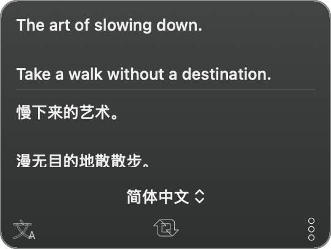

# Text

原生 macOS 菜单栏文字识别与翻译工具，使用 Swift 和 AppKit 开发。

**当前为 1.0.7 个人试用版。** 支持 Apple 芯片与 Intel，最低 macOS 13。尚未使用 Apple Developer ID 签名及公证；升级后的钥匙串授权问题仍待进一步验证，不能视为已解决的稳定版本。

[下载安装包与源码](https://github.com/cyp1175336187-blip/Text/releases/tag/v1.0.7)



上图为程序生成的示例预览，不包含用户截图或真实云服务识别内容。

## 功能

- 截图识字，或读取 PNG、JPG、HEIC、WebP 和 PDF。
- 扫描版 PDF 逐页识别，按页码顺序合并文字。
- 百度通用文字识别（标准版）与百度通用文本翻译，需自行配置服务密钥。
- 深灰结果窗口，原文与译文可编辑，支持原图对照和拖动缩放。
- 每次识别替换旧结果，保存最近一次结果并支持重启恢复。
- 菜单栏识别圆盘按本地处理阶段和已完成页数填充，不循环旋转；不代表服务商未提供的单页内部百分比。
- 语言菜单将英语、中文、韩语置顶，其余语言在分隔线下方。
- 自定义截图及显示结果快捷键，支持自动隐藏和显示时置顶。
- 本机用量计数和预设用量保护，具体额度与费用以服务商控制台为准。

## 安装与配置

1. 在 Releases 下载 DMG，打开后把 `Text.app` 拖入“应用程序”。也可下载应用 ZIP 后解压并移动至“应用程序”。
2. 从“应用程序”启动 Text。程序只显示顶部菜单栏 T 图标，不显示 Dock 图标。
3. 点击 T → 更多 → 偏好设置 → 账户，填写自己的四项百度凭据并保存。
4. 首次截图需在 macOS 系统设置中允许 Text 屏幕录制，然后退出重开。
5. 默认截图快捷键 `⌘1`，显示识别结果 `⇧⌘R`。

安装包未公证，macOS 可能阻止首次打开。此发布不包含服务密钥，也不会自动开通付费服务。

详细步骤见 [使用说明](Resources/使用说明.txt) 与 [配置指南](Resources/配置指南.txt)。配置指南中的价格与免费额度仅为注明日期的历史参考，请核对服务商当前规则。

## 已知限制

- 当前主界面固定使用百度服务；源码保留 Google 协议实现，但账户界面没有 Google 配置入口。
- 一次最多 20 个文件，单文件不超过 50 MB，单份 PDF 不超过 100 页；加密 PDF 需先解锁。
- 密钥保存在 macOS 登录钥匙串。旧记录可能绑定旧程序的代码指纹，覆盖更新后可能重复请求授权，当前机器上的升级授权验证尚未完成。
- 不要为解决本应用问题而重置整个登录钥匙串；排查应限制在 Text 自己的条目。
- 45 项测试使用隔离响应，不调用真实付费 API；不能替代服务配置后对实际 OCR、翻译及升级授权的验证。
- 已构建 arm64 / x86_64 通用二进制，Intel 设备未实机测试。

## 从源码构建

需要 Xcode Command Line Tools 与可用的 macOS SDK，最低目标 macOS 13。脚本优先使用本机已安装的 macOS 15.4 SDK，否则使用默认 SDK。

```bash
bash build.sh "$PWD/Build"
```

没有额外第三方运行时或包管理依赖。默认构建会使用临时签名；可通过以下环境变量指定自己的签名身份：

```bash
TEXT_SIGNING_IDENTITY="自己的签名身份" \
TEXT_SIGNING_KEYCHAIN="/绝对路径/自己的签名钥匙串" \
bash build.sh "$PWD/Build"
```

仓库和发布附件不包含作者的签名私钥、签名钥匙串或密码。固定证书也不能自动消除旧钥匙串条目的代码指纹限制。

## 测试与预览

请为每次测试使用全新的目录：

```bash
Build/Text.app/Contents/MacOS/Text --self-test "$PWD/test-output"
Build/Text.app/Contents/MacOS/Text --render-previews "$PWD/preview-output"
```

测试数据写入指定目录，不修改真实账户和最近结果。请参阅 [验证记录](docs/验证记录.md)。

## 数据与服务

密钥存入系统钥匙串；最近结果、原图缓存及本机计数保存在 `~/Library/Application Support/TextMenu/`。执行识别时会向选定 OCR 服务发送图片；翻译时会向翻译服务发送文字。反馈文件仅本地保存，不自动发送。

## 许可证

[MIT License](LICENSE)。
